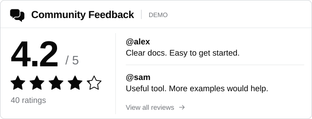
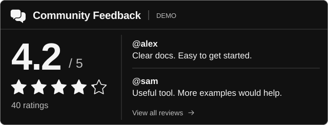
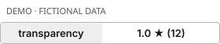
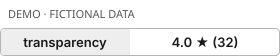
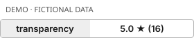
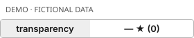

# Community Feedback

A small review service for public GitHub projects: a feedback page for readers,
and a live rating-and-review card for your README. This repository is also a
service test project; its own feedback is not an endorsement of the software.

[Open the public service](https://github-community-feedback.onrender.com/) ·
[Service documentation](feedback-service/README.md) ·
[Transparency rules](https://github-community-feedback.onrender.com/rules)

## Community feedback

Live feedback for this repository. The score and reviews below come from the
service; fictional design examples are separate.

<a href="https://github-community-feedback.onrender.com/?repo=antropos17%2Freviews-test">
  <picture>
    <source media="(prefers-color-scheme: dark)" srcset="https://github-community-feedback.onrender.com/card.svg?repo=antropos17%2Freviews-test&amp;style=card&amp;theme=dark&amp;v=horizontal-20261029">
    
  </picture>
</a>

<a href="https://github-community-feedback.onrender.com/?repo=antropos17%2Freviews-test"></a>
<a href="https://github-community-feedback.onrender.com/?repo=antropos17%2Freviews-test&amp;intent=review"></a>


## What the card looks like

The images below contain **fixed fictional examples**, generated locally. They
are not submitted reviews, real scores, or signed test-mode entries. They do not
change any repository's feedback. Every image carries its own demo label.

| Light | Dark |
| --- | --- |
|  |  |

| 1 star | 2 stars | 3 stars |
| --- | --- | --- |
|  |  |  |

| 4 stars | 5 stars | No ratings |
| --- | --- | --- |
|  |  |  |

Card includes up to three recent reviews. Compact is a single line, shield is a
classic README badge, and mini shows only the score. Themes include light,
dark, high contrast, and automatic (light/dark). The [badge builder](https://github-community-feedback.onrender.com/badge) lets
you change score, format, and theme, then enter a repository for a live snippet.
The card uses the selected horizontal layout with live ratings and separate review rows.

## Add it to your project

1. Open the service and enter `OWNER/REPOSITORY`.
2. For an organization, have an owner install the **Community Feedback Org
   Verifier** GitHub App when prompted. It needs read-only Members access to
   exclude current owners. Ratings remain unavailable if verification fails.
3. Choose **Explore badge styles** on your project's feedback page. Select a
   format and theme, then copy the generated README snippet. You can also use
   the existing **Add feedback to this repository's README** control.
4. Paste into `README.md`, commit to GitHub, and follow the card link to check
   the feedback page. GitHub's image cache and free hosting can delay updates.
5. If you want removal tracking, sign in as a repository administrator and
   choose **Activate seal** on the feedback page.

Readers browse without signing in. To rate or review, sign in with GitHub;
accounts must be at least 30 days old to appear. Ratings and written reviews
are separate. Owners cannot rate or review their own project. A GitHub account
does not establish a unique person, and the service operator controls its data.

A minimal live card (replace both occurrences of `OWNER%2FREPOSITORY`):

```html
<a href="https://github-community-feedback.onrender.com/?repo=OWNER%2FREPOSITORY">
  
</a>
```


<details>
<summary>How ratings work</summary>

Each eligible GitHub account can submit one rating and one separate review per repository. The score is the simple average of eligible ratings. Accounts must be at least 30 days old; younger accounts are included only when they reach that age. Repository owners cannot rate their own project or approve an exception.

GitHub sign-in cannot identify multiple accounts controlled by one person. Reports do not hide reviews automatically. Moderation decisions are recorded in a public log; the service operator controls its code and stored data. The card shows up to three recent reviews; the service displays more. GitHub's image cache and free hosting may delay updates. [Full transparency rules](https://github-community-feedback.onrender.com/rules).

The seal supports public owner replies, operator moderation with fixed reasons, security-concern evidence links, and scheduled removal tracking. A hidden review's rating is excluded while it is hidden. New signed events and receipts can be checked against a retained journal copy and a Rekor checkpoint. These mechanisms do not prevent an operator from changing data or ratings. Older feedback has no retroactive signatures, and a successful check with warnings does not verify it. See the [service documentation](feedback-service/README.md) for the rules and limitations.

</details>

[Compare all badge formats and themes](https://github-community-feedback.onrender.com/badge?repo=antropos17%2Freviews-test).
